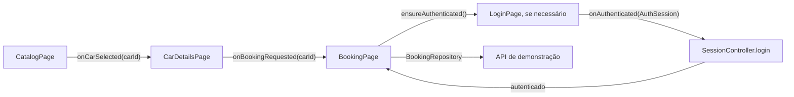

# Shell App

Aplicativo Flutter executável do monorepo DrivR. O Shell compõe Catalog,
Booking e Account em tempo de compilação e é responsável por criar as
dependências compartilhadas, coordenar a navegação e manter a sessão em
memória. Os MFEs não são carregados nem publicados separadamente.

## Inicialização e composição

O entry point [main.dart](lib/main.dart) executa `RentalApp`. O estado do
widget cria uma única instância de `SessionController` e, a partir dela, um
`ApiClient` compartilhado. O Shell injeta esse cliente nos repositories HTTP
dos MFEs e cria o `GoRouter` com esses repositories.

`RentalApp` permite injetar `CatalogRepository` e `BookingRepository`, útil
para testes ou composições alternativas. As implementações padrão são
`HttpCatalogRepository` e `HttpBookingRepository`; Account usa
`HttpAccountRepository` e `HttpAccountSduiRepository`.

O Shell configura `MaterialApp.router` com:

- tema `AppTheme.light`, proveniente do [Design System](../../packages/design_system/README.md);
- locale `pt_BR` e delegates de localização Material;
- `GoRouter` criado em [app_router.dart](lib/app_router.dart).

Ao descartar `RentalApp`, o Shell descarta o router, fecha o `ApiClient` e
descarta o controlador de sessão. O Shell é, portanto, o proprietário dessas
instâncias compartilhadas.

## Navegação e contratos entre MFEs

O [AppShell](lib/app_shell.dart) exibe as abas Início, Carros e Conta usando
`StatefulShellRoute.indexedStack`, preservando o estado das branches.
`createAppRouter` configura as rotas:

| Rota | Conteúdo |
|---|---|
| `/home` | `CatalogPage` com o título Início |
| `/cars` | `CatalogPage` com o título Buscar carros |
| `/cars/:carId` | `CarDetailsPage` |
| `/bookings/new/:carId` | `BookingPage` |
| `/account` | `AccountPage` ou `ProfilePage`, conforme a sessão |
| `/account/login` | `LoginPage` |
| `/account/register` | `RegisterPage` |

O Shell passa callbacks para os MFEs em vez de fazê-los depender de
`GoRouter`:



O callback `onClose` de Booking também delega ao Shell a ação de fechar a
rota. O fluxo de autenticação usado por Booking é implementado no Shell:

1. Se a sessão já estiver autenticada, `ensureAuthenticated` retorna `true`.
2. Caso contrário, abre `/account/login` e aguarda um resultado booleano.
3. `LoginPage` envia `AuthSession` por `onAuthenticated`; o Shell chama
   `SessionController.login` e retorna `true` à rota chamadora.
4. Booking só solicita a criação da reserva se o resultado for `true` e a
   sessão continuar autenticada.

Assim, os MFEs conhecem seus contratos de apresentação e repositories, mas não
decidem rotas entre domínios. Consulte os READMEs de [Catalog](../../packages/features/catalog_mfe/README.md),
[Booking](../../packages/features/booking_mfe/README.md) e
[Account](../../packages/features/account_mfe/README.md) para os contratos de
cada feature.

## Sessão e autenticação

[SessionController](lib/session_controller.dart) estende `ChangeNotifier` e
mantém um `AuthSession?` em memória. `login` e `logout` notificam listeners;
`isAuthenticated`, `accessToken` e `user` são derivados da sessão atual.
Account apresenta `ProfilePage` quando autenticado e `AccountPage` caso
contrário.

O token é fornecido ao `ApiClient` por uma closure que lê o estado atual do
controller. O Shell não persiste credenciais, não renova tokens e não chama um
endpoint de logout. Reiniciar o processo perde a sessão. A autenticação do
backend do monorepo é demonstrativa; não use dados reais.

## API e parâmetros de execução

O `ApiClient` é criado com a constante de compilação `API_BASE_URL`. Se ela
não for definida, o valor padrão é `http://localhost:3000`.

Na raiz do monorepo, resolva as dependências e execute o app:

```bash
dart run melos bootstrap
cd apps/shell_app
flutter run --dart-define=API_BASE_URL=http://localhost:3000
```

Para emulador Android, use `http://10.0.2.2:3000`. Em dispositivo físico,
informe o IP da máquina que executa o Mockoon. As configurações de execução do
VS Code estão em [`.vscode/launch.json`](../../.vscode/launch.json). A alteração
de `--dart-define` requer reiniciar o app; hot reload não atualiza a constante
de compilação.

O manifesto Android em `android/app/src/debug/AndroidManifest.xml` permite
cleartext HTTP no build de debug. O `Info.plist` iOS permite acesso à rede
local. Essas configurações existem para a API local de desenvolvimento e não
substituem uma configuração de transporte segura para produção.

## Limites arquiteturais

- O Shell é o ponto de composição, ciclo de vida e navegação entre MFEs.
- Regras de negócio, parsing de domínio e acesso HTTP específico ficam nos
  pacotes de feature; o Shell injeta seus repositories.
- O Shell não interpreta documentos SDUI nem contém regras de Catalog,
  Booking ou Account.
- Os MFEs são dependências Dart/Flutter do Shell e são integrados no build;
  não têm deploy independente.

## Testes

O teste existente está em [test/widget_test.dart](test/widget_test.dart). Ele
verifica uma `MaterialApp` mínima e não instancia `RentalApp` nem cobre o
roteamento real entre MFEs. Os testes de domínio e widgets estão nos próprios
pacotes; a configuração do workspace permite executá-los com
`dart run melos run test` na raiz.
